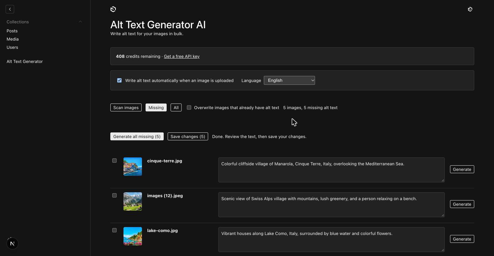
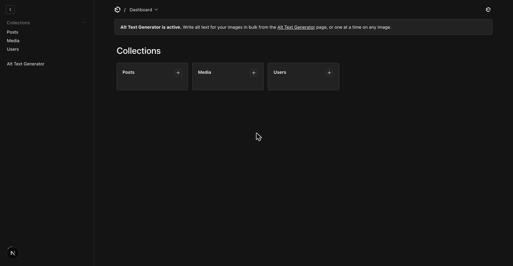
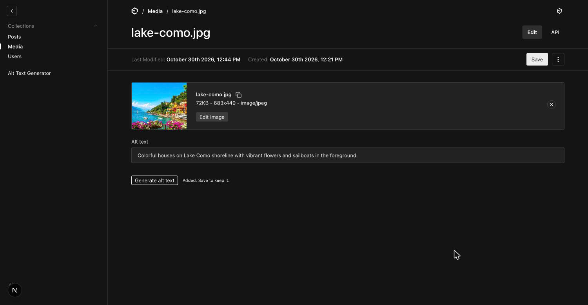
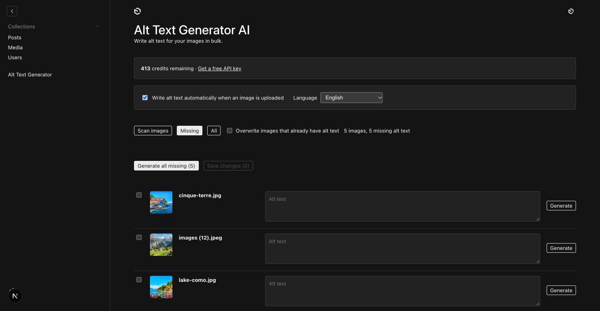

# Alt Text Generator for Payload CMS


Write SEO-friendly alt text for the images in your Payload media library. Generate it for one image, for a selection, for every image that is missing it, or automatically when an image is uploaded. 131 languages.

[Get a free API key](https://alttextgeneratorai.com/dashboard)



## What you get

- **A button on every image.** Open an image in your media collection and click **Generate alt text**.
- **A bulk page.** An **Alt Text Generator** link appears in the admin sidebar. It scans your images, shows the ones with no alt text, generates all of them or only the ones you tick, lets you edit the results, and saves them together.
- **Automatic mode.** Turn it on and new uploads get alt text the moment you save. Replacing an image's file writes new alt text for the new picture.
- **Language and locales.** Pick the language of the alt text. On sites with Payload localization, the alt text is written in the language of the locale you are editing.
- **Credits shown in the admin.** One credit writes alt text for one image. New accounts get free credits.
- **Your key stays on your server.** The API key is only used by the plugin's server code and never reaches the browser.

## Requirements

- Payload 3.92 or newer (tested on 3.92.1 with SQLite and local file storage)
- Node.js 20.9 or newer
- An Alt Text Generator API key ([get one free](https://alttextgeneratorai.com/dashboard))

## Install

```sh
npm install @balt1794/payload-plugin-alt-text-generator
```

Add the plugin to `payload.config.ts` and list the upload collections that hold your images:

```ts
import { buildConfig } from 'payload'
import { altTextGenerator } from '@balt1794/payload-plugin-alt-text-generator'

export default buildConfig({
  // ...
  plugins: [
    altTextGenerator({
      collections: ['media'],
      autoGenerate: true, // optional, can also be switched in the admin
    }),
  ],
})
```

Put your key in `.env`:

```
ALT_TEXT_GENERATOR_API_KEY=your-key-here
```

Then run:

```sh
npx payload generate:importmap
```

The import map tells Payload where to find the plugin's admin parts, so run it once after installing and restart your dev server.

### Database changes (SQL databases only)

The plugin adds one small hidden settings table (it stores the auto-generate switch and the language you choose on the Alt Text Generator page). If your collection does not already have an `alt` text field, the plugin adds that too.

- **MongoDB:** nothing to do.
- **SQLite or Postgres:** while you run the dev server, Payload updates the tables for you. For production, create and run a migration, as you do for any schema change:

```sh
npx payload migrate:create
npx payload migrate
```

## Where to find it in the admin

The plugin shows up in three places, so you can always tell it is installed:

1. **Dashboard.** A note says "Alt Text Generator is active" and links to the bulk page.
2. **Sidebar.** A new **Alt Text Generator** link opens the bulk page.
3. **Every image.** Open an image in your media collection. The alt text field has a **Generate alt text** button under it.



## Use it

### One image

Open the image, click **Generate alt text**, and save. With automatic mode on, a new image gets its alt text when you save it, so there is no need to click anything.



### Many images

1. Open **Alt Text Generator** in the sidebar. It scans your images.
2. **Missing** shows images with no alt text. **All** shows everything.
3. Tick the images you want, or leave all unticked.
4. Click **Generate selected** or **Generate all missing**.
5. Read the results, change anything you like, then click **Save changes**.

**Generate all missing** skips images that already have alt text. Tick an image to generate it anyway, or turn on **Overwrite images that already have alt text**.



### Settings on the bulk page

- **Write alt text automatically when an image is uploaded.** Saved in the database, so you can change it without editing code.
- **Language.** The language of the alt text.

## Options

| Option | Default | What it does |
| --- | --- | --- |
| `collections` | required | Upload collections to add alt text to. |
| `apiKey` | `ALT_TEXT_GENERATOR_API_KEY` | Your API key. Prefer the environment variable. |
| `autoGenerate` | `false` | Starting value for automatic mode. Whatever an admin saves on the bulk page takes over. |
| `language` | `english` | Starting language. Whatever an admin saves takes over. |
| `altField` | `alt` | The field that holds the alt text. It is created if the collection does not have it. |
| `access` | any signed-in user | Decides who may generate alt text, check credits and change the settings. |
| `disabled` | `false` | Turns the plugin off but keeps its fields so your database stays consistent. |

### Limit who can generate

Each generation uses one credit. If your `users` collection includes people who are not staff, such as customers or members, limit the plugin to your team:

```ts
altTextGenerator({
  collections: ['media'],
  access: ({ req }) => req.user?.role === 'admin',
})
```

### Sites with several languages

If Payload localization is on, the bulk page shows a **Locale** dropdown instead of a language dropdown. The alt text is generated in the language of the locale (for example `es` writes Spanish) and saved into that locale. Make your `alt` field `localized: true` to keep a separate alt text per locale.

## Privacy

When you generate alt text, a resized copy of the image (JPEG, up to 1024 px) and your API key are sent from your Payload server to `alttextgeneratorai.com`. Images are not stored by the plugin. Nothing is sent from the browser.

## Troubleshooting

| What you see | What to do |
| --- | --- |
| No **Alt Text Generator** link in the sidebar | Run `npx payload generate:importmap` and restart. |
| "No API key" | Set `ALT_TEXT_GENERATOR_API_KEY` in `.env` and restart. |
| "Invalid API key" | Copy the key again from your [dashboard](https://alttextgeneratorai.com/dashboard). |
| "No credits left on this API key" | Add credits at [alttextgeneratorai.com](https://alttextgeneratorai.com). |
| "You do not have permission to do this" | Your `access` function returned false for this user. |
| Database error about a missing table or column | Run the migration steps above. |

## Support

support@alttextgeneratorai.com, or open an issue on [GitHub](https://github.com/balt1794/payload-plugin-alt-text-generator/issues).

## License

[MIT](LICENSE) © Bryam Loaiza
